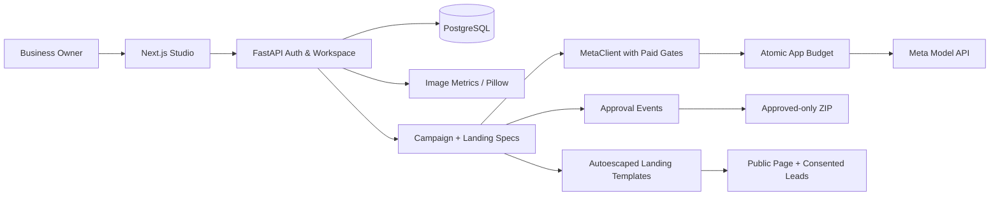

# SentinelX — Autonomous Multimodal Business Intelligence and Action Engine

**Meta AI Developer Hackathon 2026 · Indie Developer track**

**The AI that understands a business and helps run it.** SentinelX connects a reusable Visual Business Twin, cited Opportunity Hunter, Creative Execution Studio, supervised agents and Voice-to-Action. It researches evidence, proposes improvements and verifies explicitly approved self-hosted delivery. Business owners stay in control: **approval records a decision; publication is a separate authorized action.** See the [original product scope and current boundaries](docs/ORIGINAL_PRODUCT_SCOPE.md).

> Development / hackathon demonstration software. The real Meta text, vision, image and landing workflow is runtime-verified; broader production hardening remains incomplete. All sample fixtures are visibly labeled.

## The product loop

The **Research & data** workspace adds bounded multi-page website discovery, durable evidence facts and reviewable social candidates, selected-competitor comparisons, private multi-file parsing, deterministic data quality/totals and an exportable intelligence report. Its collected public evidence can feed the existing Business engine without a second crawl. Owners can also batch up to four selected website images or public-page screenshots into one consented Meta visual request; screenshot bytes are not persisted and the existing model budget still applies. No private uploaded business data is sent to AI. See [implementation, safety limits and incomplete scope](docs/PRODUCT_EXPANSION_RELEASE.md); Maps, OAuth connectors, MCP and the general universal agent are not claimed as completed.

1. **Brief:** The owner supplies their description, goal, optional website URL, product imagery and preferred language (English, Bengali or Hindi).
2. **Image measurements:** Pillow reads real pixels (resolution, brightness, contrast, texture proxy, color palette) and produces a documented technical-readiness heuristic. Optional Meta image analysis requires explicit live authorization.
3. **Business audit:** Produce a 7-day campaign with positioning hypotheses and evidence/assumption references. Demo mode uses samples; live mode uses structured Muse Spark responses.
4. **Creative concepts:** Generate 1–3 variants. Demo mode creates local labeled gradient examples; live mode uses Muse Image and scores brief alignment using image input to Muse Spark. Campaign posts include an image prompt and a timed Reels/Shorts shooting plan; the plan is not a rendered video.
5. **Landing page:** Generate and edit a validated, autoescaped page from three script-free mobile templates. Optionally embed a selected campaign creative, preview safely, obtain explicit approval and publish a read-only page with consented lead capture.
6. **Approval and export:** View proposed/approved/rejected artifacts, record reviewer/time/note, explicitly reopen decisions, and export only approved posts, images, landing HTML and evidence in a ZIP.

**Sample data is never relabeled as measured business impact.** Evidence derived from the owner's description is unverified unless independently validated. We do not claim to have crawled a URL by merely receiving it.

## Architecture



**Backend:** Python 3.11, FastAPI, Pydantic, SQLAlchemy, Alembic, PostgreSQL/SQLite dev, Pillow, Jinja2.
**Frontend:** Next.js / React / TypeScript, responsive dashboard with dedicated tool views and modal editors.
**CI:** GitHub Actions backend tests, PostgreSQL migration checks and Playwright Chromium journeys.

## Real versus sample capabilities

| Capability | Behavior | Live verification |
|---|---|---|
| Local image pixel measurements | Real, deterministic, no provider charge | Testable offline |
| Owner-scoped campaigns / approvals / ZIP | Persistent DB and authenticated APIs | Automated tests in feature PR |
| Landing previews, exports and lead forms | Script-free templates; owner approval before publishing | Automated tests in feature PR |
| Muse Spark structured text / image input | Central `MetaClient` via documented Chat Completions | **Verified on Hostinger, 28 October 2026** |
| Muse Image generation | Central `MetaClient` via Images API | **Verified on Hostinger, 28 October 2026** |
| SAM 3.1 segmentation | Raises `NotSupported` for live calls | **Not implemented** |
| Muse Voice transcription | Scoped WAV transcription to an editable goal | Documentation/HTTP-contract verified; recent account verification appears in runtime status |
| Cited opportunity discovery | Scoped Responses web search plus bounded candidate collection | Documentation/HTTP-contract verified; recent account verification appears in runtime status |
| Open-weight Spark Open / Glimmer | Future eligible inference infrastructure | **Not deployed** |
| Social publishing, measured ROI | Not performed | **Not implemented** |

`GET /api/v1/status` advertises LIVE only after a recent successful real Meta call in the running application; otherwise it reports SAMPLE. Merely configuring a key is insufficient.

## Run locally

```bash
cd backend
python -m pip install -r requirements.txt
export JWT_SECRET="$(python -c 'import secrets;print(secrets.token_urlsafe(48))')"
export INFERENCE_PROVIDER=demo
export SENTINELX_MODE=demo
export ALLOW_PAID_INFERENCE=false
export ENABLE_LIVE_MULTIMODAL=false
python -m uvicorn app.main:app --reload
```

In another terminal:

```bash
cd frontend
npm ci
npm run dev
```

Open http://localhost:3000. Windows PowerShell users should replace `export KEY=value` with `$env:KEY="value"`.

Demo defaults make **zero paid Meta requests**. For a real operator-authenticated workspace, create a local account and open the **Dashboard**. Optional guest sample sessions can be enabled with `ENABLE_PUBLIC_DEMO_SESSION=true`; they expire in 20 minutes, are rate-limited and cannot make paid requests. The public `/demo` static walkthrough does not need the backend.

### Running tests

```bash
cd backend && python -m pytest -q
cd ../frontend && npm ci && npm run build
```

Browser tests: `cd frontend && npx playwright test` (requires browsers installed, test backend and matching fixture configuration; see the CI workflow).

For PostgreSQL, use Alembic migrations with backups and review before changing an existing database. Never casually run destructive schema downgrades.

## Live Meta API safety

The owner reported that **$150 promotional credits were active** in Meta Billing on October 27, 2026. A prior smoke request returned no visible answer within a small reasoning budget; the later deployed owner workflow successfully generated real campaign, image and landing artifacts; the separate smoke workflow remains manual.

The application defaults to:
- `INFERENCE_PROVIDER=demo`
- `SENTINELX_MODE=demo`
- `ALLOW_PAID_INFERENCE=false`
- `ENABLE_LIVE_MULTIMODAL=false`
- `CAMPAIGN_WORKSPACE_MAX_ATTEMPTS=0` (zero live campaign/image/creative attempts)
- `META_APP_BUDGET_CENTS` is an **application reservation ceiling**, not a hard Meta billing limit.

To run any live feature, the operator must explicitly enable all flags and set a positive attempt quota and budget; keys remain only in server secrets. Never call Meta from the browser. **Credits can still be exhausted or charged by other apps/keys; review Meta's Usage and Billing dashboards.**

The manual GitHub Actions smoke workflow allows exactly one explicitly authorized test of text, vision or image; see [setup](docs/META_GITHUB_ONLY_SETUP.md) and [API notes](docs/META_API_NOTES.md). Do not paste your key into issues, chat or code.

## Product and security boundaries

- Workspace resources have owner-scoped lookup and bearer authentication.
- Guest sessions are isolated, short-lived, rate-limited and never invoke paid inference.
- Public pages use autoescaped Jinja2, CSP, no external scripts/fonts and unguessable slugs. Lead forms require consent and rate limiting; do not log PII.
- Public publishing requires an explicit recorded landing approval. No social publishing integration is included.
- The old crawler remains disabled for the new campaign flow; an owner-provided URL is **not** proof of independent webpage retrieval. True safe crawling needs DNS pinning and outbound filtering.
- Model JSON is validated by Pydantic, but citations/assumptions are not independently verified truth.
- Generated sample creative gradients are not actual product photography.
- Photo readiness weights are transparent engineering heuristics, **not** validated attractiveness, sales likelihood or customer impact.
- Image assessment uploads are not retained after scoring; generated creative variants are stored as bounded database blobs.
- Password login now has a shared database-backed per-account throttle. Email verification, account recovery/deletion, broader network-level abuse controls, and operational security review remain outstanding.
- PostgreSQL backup/restore was exercised and the Hostinger daily backup timer is enabled. The first CI-driven Hostinger release passed on run 40591394185, including public HTTPS health verification.
- Workspace/run model budgets and campaign attempt limits are app-side controls; provider charge reconciliation and a provider-enforced hard cap remain unimplemented. Concurrency tests and production monitoring still need expansion.

## Documentation

- [Demo and submission script](docs/DEMO_SCRIPT.md)
- [Development readiness](docs/DEMO_READINESS.md)
- [Official Meta API contract notes](docs/META_API_NOTES.md)
- [Manual GitHub-only API tests](docs/META_GITHUB_ONLY_SETUP.md)
- [Codex handoff](AGENTS.md)
- [Hostinger deployment and CI/CD status](docs/HOSTINGER_DEPLOYMENT.md)
- [Historical Oracle staging plan](deploy/ORACLE_STAGING.md)

This repository is under active review. Judge claims should be updated only after the corresponding feature is verified working on a deployed HTTPS URL.

## Evidence-to-action missions

Open **Business mission** to inspect supplied public pages, measure inquiry-path signals and produce a source-cited improvement plan with an actual tool/model execution trace. Prepare a campaign from that mission, review and publish its landing page, then explicitly verify the public page and submit/remove a labeled synthetic inquiry. No conversion improvement is claimed. See [BUSINESS_MISSIONS.md](docs/BUSINESS_MISSIONS.md) for the workflow, costs and limits.
