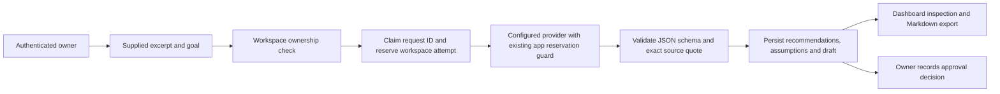

# Evidence-to-draft engineering milestone

## Audit findings addressed

1. Provider runs received only the URL and goal, while evidence audits never called a model. Added a separate, explicitly gated evidence-draft operation instead of changing the no-credit audit's behavior.
2. Empty provider responses were previously reported as successful. The prior readiness commit rejects empty/incomplete text; this milestone also rejects malformed structured output, unknown source IDs and quotes absent from the supplied evidence.
3. Repeated submissions could consume credits repeatedly. Request IDs are now scoped to a workspace and claimed durably before generation. Pending/failed requests are never automatically retried; successful replays return the saved result. Different payloads with the same request ID are rejected.
4. No workspace quota existed for this operation. A conditional database update enforces a lifetime attempt limit. Failed or interrupted attempts remain counted. This quota does not cover other endpoints and is not actual-cost reconciliation.
5. Dashboard claims of zero spending and universally simulated behavior were inaccurate when provider controls were enabled. The UI now shows unknown actual charges, operator availability, draft provenance, assumptions and request quota.
6. Schema creation depended entirely on development `create_all`. Added versioned Alembic migrations and a schema-equivalence test; staging disables automatic schema creation and the backend container migrates before starting.
7. Browser QA was missing. Added actual UI/API/DB journeys for no-credit audits and model drafts with an explicitly named offline provider fixture. These tests do not establish live Meta answer quality.
8. Mobile styling hid the only sign-out control. Added a header sign-out control and a mobile logout check; logout clears selected workspace/run state and the session request key.

## Implemented flow

No website crawl, independent fact-check or external publishing occurs. A quote match establishes text provenance only. The model's interpretation and generated copy can still be wrong and require owner review. Generated copy is an internal draft, not an externally executed action.

## API contract

`POST /api/v1/workspaces/{workspace_id}/evidence-draft` accepts the existing evidence fields plus a UUID `request_id`. The first 1,200 excerpt characters are sent to the provider; the complete supplied excerpt remains in the owner-only run record. A successful response contains `status=inferred`, provider/model metadata, usage when provided, source E1, schema-validated recommendations, assumptions and an artifact marked `draft_requires_review`.

States are `pending`, `inferred` and `failed`. Runs are persisted before the provider call. Process interruption can leave a pending run; operators must inspect it rather than blindly retry. Failure records contain a fixed error category, never raw provider output or exception text. Successful and schema-rejected provider replies preserve usage when the adapter returned it; transport/empty-response failures may have unknown usage. There is no automatic billing refund.

`GET /api/v1/workspaces/{workspace_id}/evidence-draft/status` reports operator availability and the owner's workspace attempt quota. Existing run inspection and Markdown report endpoints include the draft and its provenance. They retain owner checks. Replaying a successful request ID is free of additional provider calls; the browser retains the ID for unchanged inputs during the current session. Refreshing the browser loses that client-side key, so inspect run history before generating again.

## Operator configuration

Defaults remain `ENABLE_EVIDENCE_INFERENCE=false` and `EVIDENCE_WORKSPACE_MAX_REQUESTS=0`. The staging Compose locks these off. Do not enable the new operation publicly; global account controls, rate limits and actual provider charge reconciliation remain incomplete.

For a deliberately authorized private test only, configure a real provider, a positive app budget and `EVIDENCE_WORKSPACE_MAX_REQUESTS=1`, then set `ENABLE_EVIDENCE_INFERENCE=true`. Meta also requires `ALLOW_PAID_INFERENCE=true`, `MODEL_API_KEY` and `META_MODEL`. Keys remain server-side. This guide does not authorize a live request. The structured draft contract is mock-tested; its reliability with a real Meta response remains unverified.

## Migrations

Fresh database, from `backend`: `python -m alembic upgrade head`. Containers execute this before Uvicorn. Revision 0001 creates the existing five-table schema; 0002 adds evidence quotas. Fresh upgrade/repeat/schema-equivalence are automated on SQLite.

For an existing database created with `create_all`, **do not blindly run or stamp migrations**. Back up first, compare its actual schema with revision 0001, and only if equivalent stamp 0001 before upgrading to head. A database already containing the quota table needs comparison against head before stamping head. No existing remote database has been migrated or stamped by this work. Restore testing and deployment resource review remain outstanding.

## Reproduce local verification

Backend: install requirements, then `python -m pytest -q` from `backend`.

Browser tests: install frontend dependencies and Chromium with `npm ci` and `npx playwright install chromium`. Build with `NEXT_PUBLIC_API_URL=http://127.0.0.1:18081`, then run `npm run test:e2e`. `E2E_PYTHON` may point to the backend virtual environment's Python executable. Ports 13001/18081 must be free. The test launcher lives under backend/tests and is excluded from the backend Docker image. It stubs only the evidence provider; auth, ownership, quota, schema checks, persistence, review and exports use real application code. Its generated content explicitly states that it is an offline fixture.

GitHub CI runs backend tests, frontend production build and the browser journeys with no live credentials.

## Remaining blockers

- One complete visible Meta answer and structured-output quality check, personally authorized through the gated workflow. The previous smoke verified a response with usage but empty text.
- Provider actual-cost reconciliation across all endpoints, distributed auth/rate limits, account lifecycle controls and production readiness.
- PostgreSQL migration/concurrency verification beyond SQLite tests, backup/restore drill and isolated TLS deployment with host access.
- Real consented multimodal inference and measured owner usefulness. Existing media inspection remains validation only.
- Accepted participant rules and exact prize-stacking/submission requirements; never treat integration count as award eligibility.
